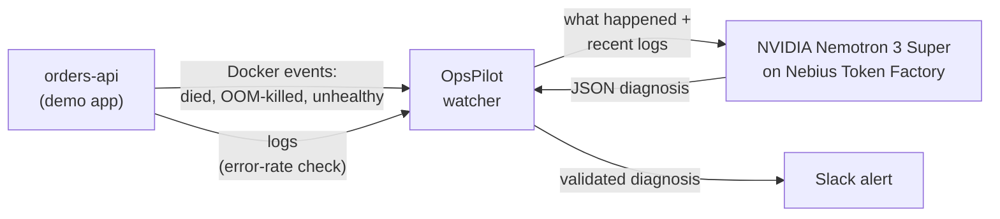

# OpsPilot

AI incident triage for containers. When a service crashes, runs out of memory, fails its health
checks or starts throwing errors, OpsPilot reads its logs, asks an **NVIDIA Nemotron** model on
**Nebius Token Factory** what went wrong, and posts a diagnosis to Slack. The diagnosis gives the
root cause, evidence quoted from the logs, severity, fix steps and how to prevent it next time.

It runs entirely on your laptop with Docker; no cloud account is needed. An AWS Lambda version of
the same pipeline is included too.

## How it works



| The watcher sees | Like this in production |
| --- | --- |
| a container dying, with its exit code and whether it was **OOM-killed** | ECS "task stopped" event |
| a container's health check turning **unhealthy** | load balancer health checks failing |
| **10+ error lines in a minute** in a container's logs | CloudWatch 5xx alarm |

The watcher then:

1. Reads the container's last 15 minutes of logs and puts what Docker reported in front of them.
2. Sends both to Nemotron and gets back a diagnosis as JSON:

```json
{
  "affected_service": "orders-api",
  "root_cause": "The order history cache never evicts entries; RSS grew to ~249 MiB against the 256 MiB limit ...",
  "evidence": ["... \"cache_mb\": 200, \"rss_mb\": 249}", "OOMKilled: true"],
  "severity": "high",
  "confidence": 0.95,
  "fix_steps": ["Raise the memory limit ...", "Bound the cache with an LRU or TTL ..."],
  "prevention": ["Alert on memory above 80% of the limit ..."],
  "summary": "orders-api OOM-killed: unbounded cache exceeded its 256 MiB limit"
}
```

The diagnosis is posted to Slack, colour-coded by severity.

## Quick start (free, runs locally)

You need Docker Desktop, a [Nebius Token Factory](https://tokenfactory.nebius.com) API key and a
Slack [incoming webhook](https://api.slack.com/messaging/webhooks).

```powershell
# 1. Configure: fill in NEBIUS_API_KEY and SLACK_WEBHOOK_URL
copy .env.example .env

# 2. Start the demo app, some traffic, and the OpsPilot watcher
docker compose up -d --build

# 3. Break the app on purpose, and watch the diagnosis arrive in Slack
$env:FAIL_MODE="oom"; docker compose up -d
docker compose logs -f opspilot

# 4. Back to normal, and stop everything when done
$env:FAIL_MODE=""; docker compose up -d
docker compose down
```

The failure modes (see [demo-app/README.md](demo-app/README.md)), with live results from Oct 29, 2026:

| `FAIL_MODE` | What breaks | OpsPilot's diagnosis | Severity | Time to Slack |
| --- | --- | --- | --- | --- |
| `oom` | A cache that never evicts grows until the container is OOM-killed | "cache warmer raised RSS to ~249 MiB, exceeding the 256 MiB limit" | high | 28 s |
| `missing_env` | Startup crashes: `DATABASE_URL` is not set | "missing DATABASE_URL environment variable during startup" | critical | 11 s |
| `bad_health` | `/health` depends on an unreachable Redis and returns 500 | "health checks failing due to timeout connecting to Redis" | medium | 39 s |
| `errors` | Half of `/orders` requests hit a `None` price and raise `TypeError` | "None unit_price causing TypeError in order total calculation" | high | 44 s |

The demo app's logs never mention `FAIL_MODE`, so every diagnosis comes from the symptoms alone.
Everything runs locally; the only paid part is the Nemotron call, about $0.002 per diagnosis on
Nebius.

## Why you can trust the diagnosis

- **Evidence is checked.** Every quoted log line is checked against the real logs, and any quote
  the model made up is dropped.
- **The output is validated.** The JSON is checked field by field. If it's invalid, the model is
  shown exactly what was wrong and asked once more.
- **No invented values.** The prompt makes the model use only names and IDs from the logs, and
  placeholders like `<cluster-name>` otherwise. Logs are treated as untrusted data, so
  instructions hidden in them are ignored.
- **No alert storms.** Each failing container is posted once, so a crash loop doesn't flood Slack.
  If the diagnosis itself fails, Slack still gets what was reported.

## Model choice

`compare_models.py` runs the same prompt and logs through each model. Results on the three
sample incidents in `samples/` (Oct 27, 2026):

| Model | ALB outage (expect critical) | Repeated OOM kills (expect high) | Rolled-back deploy (expect medium) | Avg time | Cost per diagnosis |
| --- | --- | --- | --- | --- | --- |
| **Nemotron 3 Super 120B-A12B** | critical ✅ | high ✅ | medium ✅ | ~10 s | ~$0.0025 |
| Nemotron 3 Nano 30B-A3B | high ❌ | high ✅ | high ❌ | ~28 s | ~$0.0007 |

Both found the right root cause every time. Super also ranked severity correctly, quoted more
precise evidence and gave runnable fixes, so OpsPilot uses `nvidia/nemotron-3-super-120b-a12b`.
Switching models only means changing `NEBIUS_MODEL`.

## Development

```powershell
python -m venv .venv
.venv\Scripts\Activate.ps1
pip install -r requirements-dev.txt

python run_local.py samples/ecs_oom.log        # diagnose a single log file
python run_local.py --list-models              # Nemotron model IDs your key can use
python compare_models.py                       # compare models side by side
python watch_docker.py                         # run the watcher outside Docker
python -m pytest                               # 33 tests; they never call the real API
```

## Running on AWS (optional)

The same pipeline is packaged as an AWS Lambda, `opspilot.handler.lambda_handler`. It's triggered
by an EventBridge rule for ECS tasks that stop unexpectedly, or by a CloudWatch alarm delivered
through SNS. It reads the task's CloudWatch logs and takes its secrets from SSM Parameter Store.
It's tested locally with sample AWS events and the demo app's real logs, but not deployed:

```powershell
python run_lambda_local.py samples/events/ecs_task_stopped_oom.json samples/docker/oom.log
python run_lambda_local.py samples/events/alarm_5xx_sns.json samples/docker/errors.log --post
```

## Project layout

| Path | What it does |
| --- | --- |
| `opspilot/diagnose.py` | `diagnose(logs) -> dict`: prompts Nemotron, extracts and validates the JSON, checks evidence against the logs, retries once if invalid. |
| `opspilot/pipeline.py` | Shared by every trigger: diagnose an incident, post it to Slack, skip repeats. |
| `opspilot/docker_watch.py` | The local watcher: Docker events (died, OOM-killed, unhealthy) plus an error-rate check. |
| `opspilot/slack.py` | Formats the diagnosis as a Slack message and posts it to an incoming webhook. |
| `opspilot/events.py`, `logs.py`, `handler.py` | The AWS version: ECS events and CloudWatch alarms in, CloudWatch Logs read, Lambda entry point. |
| `watch_docker.py`, `Dockerfile`, `docker-compose.yml` | Run the watcher, alone or next to the demo app and a traffic generator. |
| `demo-app/` | `orders-api`, a small FastAPI service with `FAIL_MODE` switches that cause real incidents. |
| `run_local.py`, `compare_models.py`, `run_lambda_local.py` | Local tools: diagnose a log file, compare models, run the Lambda handler. |
| `samples/` | Incident logs, sample AWS events (`events/`) and real logs from each demo-app failure (`docker/`). |
| `tests/` | pytest suite using fakes for Docker, AWS and the model. |
| `.env.example` | Template for `NEBIUS_API_KEY`, `NEBIUS_BASE_URL`, `NEBIUS_MODEL`, `SLACK_WEBHOOK_URL`. Copy it to `.env` (git-ignored). |

## License

[MIT](LICENSE)
